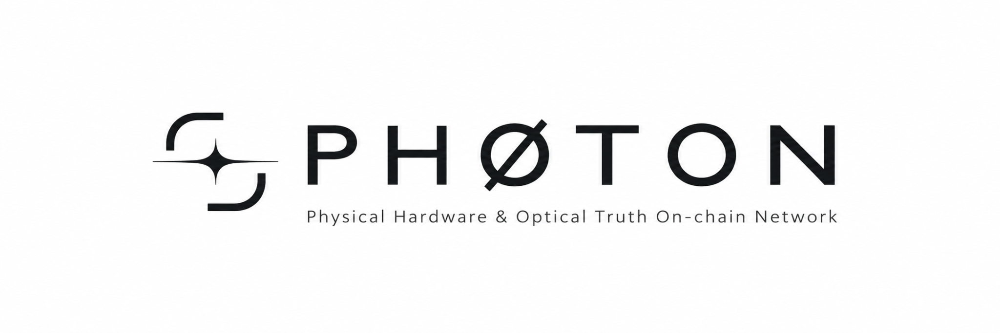
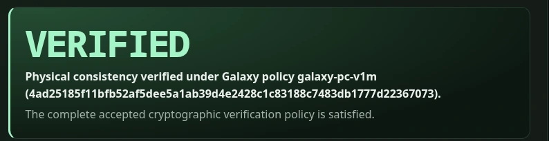
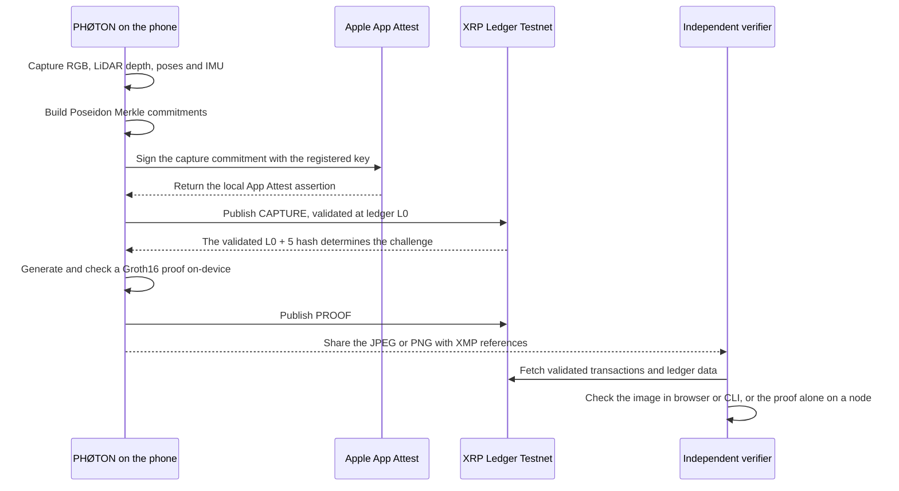
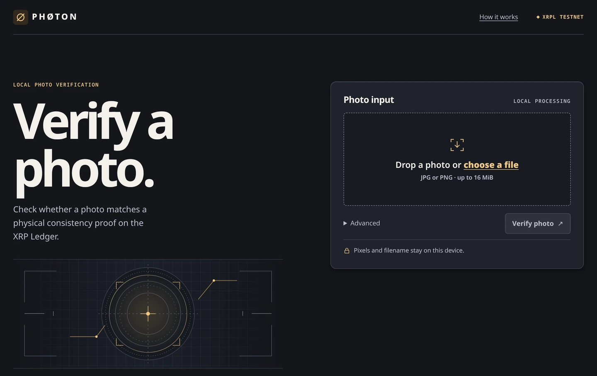

# PHØTON

<picture>
  <source media="(prefers-color-scheme: dark)" srcset="docs/assets/photon-logo-dark.webp">
  
</picture>

<p><sub>Physical Hardware &amp; Optical Truth On-chain Network</sub></p>

PHØTON lets anyone verify that a photo from a phone matches a zero-knowledge proof of physical consistency on the XRP Ledger, without uploading the image or relying on a project server. The protocol is designed to support different devices through capture profiles.

**MVP: iPhone with LiDAR.**

[](#see-it-on-the-ledger)
[](#cryptography)
[](crates/)
[](LICENSE)

## See it on the ledger

**`VERIFIED` · 39 checks passed.** The iPhone captured the evidence, generated the proof, and published both photo transactions on XRPL Testnet. The Linux and macOS CLI and browser verifiers independently checked the original JPEG. The private photo is not in this repository.

| Validated Testnet record | What to look for |
| :--- | :--- |
| [CAPTURE `7DEA7F30…`](https://testnet.xrpl.org/transactions/7DEA7F30DBCEBE5461CDC1E57B2E3E66A4F5617D6708F6B0250796B3BF4C369D) | Image and evidence commitments, with an Apple App Attest assertion |
| [PROOF `F50D1D20…`](https://testnet.xrpl.org/transactions/F50D1D20B1B784657B941CD291B6EB44B9B332AF63D8A1356C144C94C69C7800) | Groth16 proof generated on the iPhone |
| [CIRCUIT `B0C14DC5…`](https://testnet.xrpl.org/transactions/B0C14DC5C6BEC26A5C43CD236383EC1893F164DF0047498ACF38F67C4DC75D66) | Registration of the policy and verification-key bundle |
| [DEVICE `76D0884D…`](https://testnet.xrpl.org/transactions/76D0884DDC2129FCE8D906B92468943D12377418711B5A111A07C2379FAC7A91) | The phone’s App Attest credential in Apple’s development environment |

[Full measured verdict and tamper checks →](docs/measurements.md#first-phone-certified-photo)



## How it works

PHØTON is the product; [Galaxy v1](docs/protocol/galaxy-v1-spec.md) is the protocol. This flow shows the current iPhone profile, `galaxy-pc-v1m`.



1. The phone captures synchronized RGB frames, LiDAR depth, camera poses, and IMU readings.
2. Poseidon Merkle roots bind the image and sensor evidence; App Attest binds the CAPTURE to a registered app instance.
3. The validated ledger at `L0 + 5` determines which parts of the committed evidence the proof must check.
4. The phone generates and verifies the Groth16 proof locally, then publishes PROOF.
5. The exported JPEG or PNG carries XMP references. The browser and CLI check the file against XRPL; a lookup node can check the proof but never receives the image.

## Why XRPL?

- **Cheap writes and fast validated closes.** The showcased capture paid **10 drops per transaction**, **20 drops across two writes**. In several measured runs, five validated closes took 19–20 seconds (about 4 seconds per close). Submit-to-observed validation includes polling and network time.
- **A public challenge after commitment.** The hash of validated ledger `L0 + 5` sets the sample after CAPTURE is fixed. Every verifier derives the same challenge; there is no project challenge server. This is not a claim of unbiased randomness. [Ledger timeline](docs/assets/ledger-challenge.svg)
- **Native records and signed history.** `AccountSet` memos carry registrations, commitments and proofs without a smart contract. `AccountTxnID` gives each device account a ledger-enforced predecessor chain for reconstructing the account’s own transaction history.
- **Permissionless verification.** Anyone with the export and XRPL history can run the same verifier. Optional lookup nodes suggest references, never verdicts. The XRPL RPC source is still trusted for validated history and completeness; operators can use their own `rippled`.

## Cryptography

The **876,639-constraint Groth16 circuit over BN254** proves that the ledger-selected samples open the Poseidon Merkle commitments and satisfy the public `galaxy-pc-v1m` policy for sensor quality, LiDAR geometry, RGB–depth agreement, temporal consistency, and motion/IMU agreement. The verifier also binds the canonical RGB raster to the CAPTURE. Apple App Attest authenticates the app instance and its assertion; Ed25519 signs XRPL records. Neither authenticates every sensor reading.

Raw sensor data and pixels stay off-ledger. Bluetooth and camera-noise aggregates are **committed only**: the circuit does not prove properties about them.

## Capture profiles & roadmap

Galaxy v1 versions capture profiles and policies. Each profile defines its sensors, policy, and proof circuit. A `CIRCUIT` registration publishes the policy and verification key on XRPL; verifiers pin the circuits they accept.

- **Implemented:** `galaxy-pc-v1m` uses iPhone LiDAR and Apple App Attest.
- **Planned, not implemented:** Profiles for phones without LiDAR could use multi-camera stereo, dedicated time-of-flight depth sensors, or depth from camera motion (for example, ARCore Depth). On Android, we plan to evaluate hardware-backed Android Key Attestation and Play Integrity for the role App Attest fills today.

The verification flow stays the same: **CAPTURE → ledger challenge → PROOF → anyone can verify**.

## Measurements

| Metric | Observed | Source |
| :--- | :--- | :--- |
| CAPTURE / PROOF transaction size | 673 / 590 B signed; 442 / 361 B of MemoData | [First phone-certified photo](docs/measurements.md#first-phone-certified-photo) |
| Per certified photo | 2 transactions, 20 drops total; registration is separate | [Validated phone transactions](docs/measurements.md#first-phone-certified-photo) |
| Submit → observed validated | 4.5–7.8 s per transaction | [Hardened Testnet desktop runs](docs/measurements.md#real-device-captures-after-accounttxnid-hardening) |
| Groth16 on iPhone 13 Pro Max | 6.2–9.1 s, ~1.0 GiB peak physical memory | [Device timings](docs/measurements.md#on-device-proving-and-capture-timings) |
| Shutter → certified on iPhone 13 Pro Max | 35–46 s in measured device runs, not the first historical pair | [Device timings](docs/measurements.md#on-device-proving-and-capture-timings) |
| Browser verification of the phone JPEG | ~6 s live Testnet; ~1 s replaying XRPL replies | [Browser results](docs/measurements.md#first-phone-certified-photo) |

## Try it

**Browser.** Run `./serve-local.sh` from the presenter package, or build and serve from the checkout with `make verifier-build` and `make verifier-run`. Open the URL shown, drop an original certified JPEG or PNG, and choose **Verify photo**. The browser keeps the file local and reads Testnet. See the [browser runbook](docs/verifier-web.md) for prerequisites.



**CLI.** Build and verify the same photo without a lookup node:

```sh
scripts/with-slot.sh cargo build --locked --release -p galaxy-cli
target/release/galaxy verify path/to/certified.jpg --no-discovery
# No image needed with Testnet access; this does not check image binding.
target/release/galaxy proof verify F50D1D20B1B784657B941CD291B6EB44B9B332AF63D8A1356C144C94C69C7800
```

**Offline fallback.** The [CLI recording example](docs/cli.md#examples) checks a bundled development fixture from recorded XRPL replies. Its `UNSUPPORTED` verdict is expected: the fixture has no App Attest credential.

**Node and iOS.** Run `make node-run` to start the optional Testnet index ([node runbook](docs/node.md)). Follow the [iOS build and signing runbook](docs/protocol/ios-capture.md#morning-checklist-mac-and-physical-iphone) to build the capture app and install matching proving files on a LiDAR-capable iPhone.

## Limits

- **Physical consistency is not scene authenticity.** A compromised acquisition pipeline can supply coherent synthetic evidence. In calibration, substituted depth could pass `galaxy-pc-v1m`; this circuit is not a reliable detector of that manipulation.
- **Testnet only.** The accepted circuit uses a single-party development setup, not a production ceremony. The demonstrated build uses Apple App Attest’s development environment.
- **App identity is not sensor provenance.** Attestation does not vouch for individual LiDAR or camera samples, and ledger close time is not a trusted shutter timestamp. See the [threat model](docs/security/threat-model.md).

## Repository

| Path | Contents |
| :--- | :--- |
| [`apps/capture-ios/`](apps/capture-ios/) · [`apps/verifier-web/`](apps/verifier-web/) | Capture app and browser verifier |
| [`crates/`](crates/) | Shared Rust core, verifier, CLI (`galaxy`), node (`galaxy-node`), and mobile/WASM bindings |
| [`circuits/`](circuits/) · [`policies/`](policies/) | Circom sources, proving setup and public policy |
| [`deployments/`](deployments/) · [`test-vectors/`](test-vectors/) | Network and node configuration, cross-language vectors, and public ledger recordings |

[Galaxy v1 specification](docs/protocol/galaxy-v1-spec.md) · [Architecture decisions](docs/adr/README.md) · [Threat model](docs/security/threat-model.md) · [Security review](docs/security/review-2026-11-21.md) + [remediation](docs/security/review-2026-11-21.md#remediation-re-review-2026-11-21-0515) · [Measurements](docs/measurements.md) · [Progress](docs/PROGRESS.md)

## Team

[Nicola Balzano](https://github.com/nicolabalzano) · [Valerio Bertinetto](https://github.com/uwu-k) · [Diego Lasorsa](https://github.com/utcq) · [Giuseppe Moscatelli](https://github.com/GiuMox) · [Ivan Terracciano](https://github.com/Sx4DoW)

## License

PHØTON is proprietary; all rights reserved. See the [PHØTON Proprietary License](LICENSE). The contents of [`circuits/`](circuits/) are licensed under [GPL-3.0-only](circuits/LICENSE) because they incorporate circomlib. Third-party components remain under their own licenses; see [Third-Party Notices](THIRD_PARTY_NOTICES.md).

PHØTON and the PHØTON logo are trademarks of the copyright holders. No trademark license is granted.
